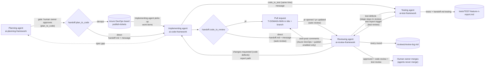

# Handoff pipeline

How a feature moves between the four agents, one per framework. Each agent reads `../ai-framework.config.yaml` first (`agents` and `handoff` sections), then this file.

The frameworks are written for **roles**, so any agent can fill one: the framework docs say *the planning agent*, *the implementing agent*, *the testing agent*, *the reviewing agent* and *the human owner*. `agents` in the config maps each role to the agent filling it today (`name`) and to the `id` used for `owner` / `updated_by` in `handoff.md`. The ids are machine-readable and stay as they are, whichever agent fills the role.

| Role (config key) | Agent today | Id | Owns | Brief |
|-------------------|-------------|----|------|-------|
| Planning agent (`agents.planning`) | **Plan Bot** | `plan-bot` | `ai-planning-framework/` | `ai-planning-framework/AGENT-BRIEF.md` |
| Implementing agent (`agents.code`) | **Dev Bot** | `dev-bot` | `ai-code-framework/` (active API / UI from `development`) | `ai-code-framework/AGENT-BRIEF.md` |
| Reviewing agent (`agents.review`) | **Review Bot** | `review-bot` | `ai-review-framework/` | `ai-review-framework/AGENT-BRIEF.md` |
| Testing agent (`agents.testing`) | **Test Bot** | `test-bot` (never an `owner`: it writes only the `testing` section and `tests/`) | `ai-test-framework/` | `ai-test-framework/AGENT-BRIEF.md` |
| Human owner (`agents.human`) | **Neil** | `human` | Approvals and the merge | — |

The state of every feature lives in **one file**: `<output.work_dir>/<feature>/handoff.md` (template: `templates/handoff.md`). Agents pass each other the feature path only; everything else is read from that file. Every review round, on either route, is also appended to `<output.work_dir>/<feature>/reviews/review-log.md`.

Reviews are **automatic**: the reviewing agent starts as soon as the implementing agent hands off directly or a PR is raised or updated (`review.auto_review`, `review.triggers`). Nobody has to ask for a review.

Tests run **alongside the review** (`testing.mode: alongside-review`, Neil 2026-10-08 19:07 BST): the same hand-off also notifies the testing agent (`handoff.code_to_test`), which writes and runs the scenario tests while the reviewing agent reviews the code. When the run finishes, the reviewing agent reviews the tests too, and only then gives the final verdict. See **Testing alongside review**.

## Flow



## Routes

Set in `handoff` in the config. The agent handing off records the route it used in `handoff.md` `routes`.

| Key | Values | What happens |
|-----|--------|--------------|
| `plan_to_code` | `direct` (default) | The planning agent writes `handoff.md` (stage `in-development`, owner `dev-bot`) and messages the implementing agent with the feature path. |
| | `devops` | The planning agent publishes `tickets/` via `skills/publish-tickets/SKILL.md` (`tickets.target` picks the adapter; `azure-devops` for this route), records the work item IDs in `handoff.md`, and sets owner `dev-bot`. The implementing agent picks the items up from the board and finds the feature through the `T-<DOMAIN>-NNN` in each title. Needs `tickets.enabled: true`, no `<placeholders>` under `tickets`, and the DevOps connector. If any is missing, fall back to `direct` only after asking the human owner. |
| `code_to_review` | `direct` (default) | The implementing agent fills the `implementation` manifest in `handoff.md` (every file that implements the plan; hand-off is blocked while it is empty), plus branch / head commit where the repo is under git, and messages the reviewing agent. That message is the `direct-handoff` trigger. The reviewing agent reviews straight away on the **plan scope** (`review.direct_scope: plan`): all code relevant to the plan, from the manifest cross-checked by a codebase search, read as whole files. No git or `target_branch` is needed. Output: `reviews/DIRECT-<branch-slug>-<n>-review.md` (or `DIRECT-<feature>-<n>-review.md` with no branch) plus a round in `reviews/review-log.md`. `direct_scope: diff` falls back to a local git diff. |
| | `pr` | The implementing agent raises a PR per repo (title and branch contain the ticket ID) and records id / url in `handoff.md`. The PR being opened or updated triggers the review (`pr-opened` / `pr-updated`; see **How the review trigger fires**). The reviewing agent reviews the **PR diff**, writes `reviews/PR-<id>-review.md`, posts inline + summary comments to the PR only when `review.publish` allows (provider `azure-devops` only; off until Azure DevOps is in use), and appends a round summary to `reviews/review-log.md`. Needs `review.provider` configured with no placeholders. |
| `code_to_test` | `direct` | At the **same time** as `code_to_review`, the implementing agent messages the testing agent with the feature path. No stage change: the feature stays `in-review`, owned by `review-bot`. The testing agent writes and runs the scenario tests, fills `testing` in `handoff.md` and writes `tests/` (its carve-out), then messages the reviewing agent (`test-report` trigger). |
| `review_feedback` | `direct` | The reviewing agent sets the stage and messages the implementing agent the report path; the findings are in the report and `reviews/review-log.md` (and on the PR only on the Azure DevOps PR route with publishing on). A `devops` option (comment on the work item) can come later. |

## Stages

`stage` in `handoff.md` is always one of these. `owner` says who may act.

| Stage | Owner | Meaning | Set by |
|-------|-------|---------|--------|
| `planned` | `plan-bot` (or `human` while waiting on the `plan_to_code` approval) | Plan, specs, Excel, journeys and tickets are ready; not yet handed to code | Planning agent |
| `in-development` | `dev-bot` | The implementing agent is building, testing and optimising | Planning agent (hand-off) |
| `in-review` | `review-bot` | The reviewing agent is reviewing the PR or the direct hand-off (starts automatically) while the testing agent writes and runs the scenario tests; then the reviewing agent reviews the tests. The code-review verdict is provisional until the test review | Implementing agent |
| `changes-requested` | `dev-bot` | Review verdict **Request changes**; the implementing agent fixes the findings | Reviewing agent |
| `approved` | `human` | Verdict **Approve** or **Approve with comments**; waiting for the human owner to merge | Reviewing agent |
| `merged` | `human` | The human owner has merged; the feature is done | Human owner, or an agent recording it on the human owner's word |

**Parked is not a stage.** A feature the human owner has parked (`parked: true`, rule 13) keeps its `stage`; parking and resuming are not transitions and need no gate.

### Allowed transitions

| From | To | By | Route / gate |
|------|----|----|--------------|
| (new) | `planned` | Planning agent | After `generate-tickets` (loop stage 4) |
| `planned` | `in-development` | Planning agent | `plan_to_code`; the human owner's approval first when `require_human_approval.plan_to_code` is `true` |
| `in-development` | `in-review` | Implementing agent | `code_to_review`; no approval by default (`require_human_approval.code_to_review: false`), and the review starts automatically. Needs `code.pre_handoff_gate: pass` (rule 12) |
| `in-review` | `changes-requested` | Reviewing agent | `review_feedback`: code defects from the code review or the test review (failing scenarios caused by the code) |
| `in-review` | `approved` | Reviewing agent | Final approval: code review **and** test review both pass (`testing.final_approval_requires`); with testing `blocked`, see default (2) in **Testing alongside review** |
| `changes-requested` | `in-review` | Implementing agent | `code_to_review` (same route as before) **and** `code_to_test` (the testing agent re-runs). Needs `code.pre_handoff_gate: pass` (rule 12) |
| `approved` | `merged` | Human owner | `merge` gate — always human |
| `in-development` / `changes-requested` | `planned` | Implementing agent | Spec gap: the spec or ticket is wrong or missing a mapping. Owner `plan-bot`; the `plan_to_code` gate applies again |

Test defects (a weak, mis-tagged, mocked or missing test) do not change the stage: the reviewing agent records them, messages the testing agent, and the feature stays `in-review`.

Any other move is a skipped gate. Do not make it.

## Rules

1. **One owner at a time.** Only the agent named in `owner` acts on the feature or edits `handoff.md`. Everyone else may read. **One exception:** the testing agent may write the `testing` section of `handoff.md` and the feature's `tests/` folder while `review-bot` owns the feature (see **Testing alongside review**); nothing else. Handing off is the owner's last write: set the new `stage`, `owner`, `pickup: pending`, then message.
2. **Update `handoff.md` on every transition.** Change the front matter **and** append one row to **History** (never rewrite earlier rows). Use ISO 8601 times with offset (e.g. `2026-10-08T10:40:00+01:00`).
3. **Pick up explicitly.** The receiving agent sets `pickup: accepted`, `updated_at`, `updated_by` and adds a History row before doing any work.
4. **Never skip gates.** Follow the transitions table. When a `require_human_approval` flag is `true`, set `owner: human` and `waiting_on`, ask the human owner, and record `approved_by` / `approved_at` only from the human owner's explicit reply. An agent never approves a gate for the human owner.
5. **Agents never merge.** `require_human_approval.merge` is always `true`. Agents do not merge, complete, approve-vote or delete branches.
6. **Message the next agent by name, with the feature path only.** Use `templates/handoff-message.md`. Do not paste specs, tickets or diffs; the next agent reads them from the feature folder.
7. **Blocked? Keep ownership.** Add the reason to `blockers`, set `waiting_on`, and message the human owner, not the next agent. A `<placeholder>` in the config that you need is a blocker; do not guess.
8. **Specs belong to the planning agent.** The implementing, testing and reviewing agents never edit `specs/`, `excel/` or `tickets/`. A spec problem goes back to the planning agent (transition to `planned`) or into the review's out-of-scope notes.
9. **Cap review rounds.** When `review.cycle` reaches `handoff.max_review_cycles` and the verdict is still Request changes, the reviewing agent sets `owner: human` (stage stays `changes-requested`) and asks the human owner how to proceed. Test-fix rounds do **not** count toward this cap; they have their own, separate cap (`testing.max_test_fix_cycles`, 5; `testing.failures_count_toward_review_cycles: false`). See **Testing alongside review**, point 9.
10. **The implementing agent records what it built.** Before every hand-off to the reviewing agent, the implementing agent fills `implementation` in `handoff.md` (files under api / ui / tests / migrations, each with tickets and the spec pages / controls / DB columns it implements). An empty manifest blocks the hand-off.
11. **Examples are never work.** A `handoff.md` with `example: true` is illustrative. Do not pick it up or act on it.
12. **Pre-handoff gate.** Before every hand-off to the reviewing agent, the implementing agent runs the pre-handoff checks (`verification` in the config; feature-build stage 5) and records one line per check in `code.verification` (never a secret value), plus `code.pre_handoff_gate: pass | fail` and `code.pre_handoff_gate_at` for the last run. A missing or failed gate blocks `in-development` / `changes-requested` → `in-review`. If a hand-off arrives without `pre_handoff_gate: pass`, the reviewing agent returns it to the implementing agent without a review round (no `review.cycle` increment) and adds a History row. Applies from each feature's next hand-off; existing `handoff.md` files are not rewritten.
13. **Parking.** A missing `parked` field means `false`. Only the human owner parks or resumes a feature; an agent records it only on the human owner's explicit word. **Park:** set `parked: true`, `parked_at` (ISO 8601 with offset), `parked_by: human`, `owner: human` and `waiting_on: "PARKED by <human owner> <date time>; resume only on <human owner>'s go-ahead"`; keep `stage` as it is and append a History row. While `parked: true` the feature is read-only for every agent, like `example: true` (rule 11): no pickup, build, review, test run or hand-off, and no `parked` entry is needed in `blockers`. **Resume:** only on the human owner's go-ahead, set `parked: false` (clear `parked_at` / `parked_by`), `owner` back to the role that owns the current stage (Stages table), `pickup: pending`, update `waiting_on`, and append a History row.

## Shared editing rules (all bots)

These apply to every agent that edits a shared or feature file in `ai-framework/`.

1. **Hash before and after.** Before changing any shared or feature file, re-read it from the machine and record its SHA-256. Confirm the hash is unchanged immediately before writing, and verify it again after writing.
2. **Targeted edits only.** Never regenerate or overwrite a whole hand-written file, and leave parked features and other agents' frameworks alone.
3. **Encoding and line endings.** Write UTF-8 without BOM and keep each file's existing line endings; never mix CRLF and LF.
4. **Planning-framework check.** After any change in `ai-planning-framework/`, run `py tools/check.py` there and hand off only when it ends `RESULT: PASS`.

## Testing alongside review

Neil chose this on 2026-10-08 (19:07 BST: option B, plus a review of the tests). Config: `testing` and `handoff.code_to_test`.

1. **Parallel notification.** When the implementing agent hands off (`in-development` or `changes-requested` → `in-review`), it messages the reviewing agent (`code_to_review`, code review) **and** the testing agent (`code_to_test`, scenario tests) at the same time. There is no new stage; the feature stays `in-review`, owned by `review-bot`.
2. **Ownership of test work** (`testing.ownership`):
   - The implementing agent owns the test **scaffolding**: the `Api.Framework.Tests` project, and the Playwright + playwright-bdd setup and `e2e/` folder in UI.NextJs.Framework. It also owns the test-data **reset endpoint** and the **test users** (personas). It lists these in `implementation.tests` / `api`.
   - The testing agent owns the **scenario tests** (unit and e2e, one per `<ticket>/S<n>`, tagged with that ID) and **running** them.
3. **The testing agent's carve-out from rule 1.** While `review-bot` owns the feature, the testing agent may write **only**:
   - the `testing` section of `handoff.md`: `status` (`pending | running | passed | failed | blocked`), `round`, `test_fix_cycle` (test-fix rounds used, max `testing.max_test_fix_cycles`; see point 9), `plan`, `report` (`tests/TEST-<feature>-<n>-report.md`), `summary` counts, `results` (one entry per explicit scenario ID `<ticket>/S<n>`), `blockers`, `updated_at`, `updated_by: test-bot`;
   - the feature's `tests/` folder (`tests/test-plan.md`, run reports, `tests/test-log.md`).
   Setting `status: running` (with `updated_at`) is its pick-up; it does not touch `pickup`. It never changes the front matter, `stage`, `owner`, `review`, `approvals`, `implementation`, History or any other section. Its own run history is `tests/test-log.md`; the reviewing agent records each test review in History.
4. **Done → message the reviewing agent.** When a run ends (`passed`, `failed` or `blocked`), the testing agent updates `testing` and messages the reviewing agent by name with the feature path and report path. That message is the `test-report` review trigger.
5. **Provisional code verdict.** The reviewing agent's code-review verdict is recorded as `review.code_verdict` and is **provisional** until testing finishes. Whether a code-review Request changes goes to the implementing agent at once or waits for the test run is default (4) below.
6. **Test review.** On the `test-report` trigger the reviewing agent reads the report and `testing`, checks the results, reviews the test code (scenario tagging with explicit IDs, no front-end mocks, every e2e scenario resets its own data first, assertions that check the Given / When / Then outcomes) and checks that **every scenario has a real test**. It records `review.test_verdict`.
7. **Final approval needs both** (`testing.final_approval_requires: [code_review, test_review]`). Only then does `review.verdict` become approve / approve-with-comments and the stage `approved`. Failures are change requests, routed by cause (`testing.defect_routing`):
   - **code defects** (the code does not do what the scenario says) → implementing agent, stage `changes-requested`; its re-hand-off notifies both agents again;
   - **test defects** (weak, mis-tagged, mocked or missing tests) → testing agent; the stage stays `in-review` and the testing agent re-runs and reports again.
8. **Review log.** Every code review and every test review is a line in `reviews/review-log.md`.
9. **Separate test-fix cap** (Neil, 2026-10-08 19:19 BST). Fixing failing tests has its own limit, `testing.max_test_fix_cycles: 5`, counted in `handoff.md` `testing.test_fix_cycle` (starts at `0`). It is separate from `handoff.max_review_cycles` (3): test-fix rounds never increase `review.cycle`, and code-review rounds never increase `test_fix_cycle` (`testing.failures_count_toward_review_cycles: false`).
   - **What counts as a round:** each failed test run (or test review requesting changes) that the reviewing agent routes back for a fix is one test-fix round, whether it goes to the implementing agent (code defect) or the testing agent (test defect). A run with both kinds of defect is still one round. A run that passes or is `blocked` is not a round.
   - **Who counts:** the testing agent adds 1 to `test_fix_cycle` when it starts the re-run that follows a routed-back failure (at the same time as `status: running`), so the value is always the number of fix rounds used so far.
   - **Escalation:** when a test review would route failures back again and `test_fix_cycle` has already reached `testing.max_test_fix_cycles`, the reviewing agent does not route them. It sets `owner: human` (stage `changes-requested`), records the reason in `blockers` and History, and asks the human owner how to proceed, the same as the review-round cap (rule 9).
   - **Review rounds are unaffected:** rule 9 still caps code-review rounds at `handoff.max_review_cycles` (3).

**Defaults flagged to Neil** (set in `testing`; not settled until he confirms):

1. **Decided** (Neil, 2026-10-08 19:19 BST; no longer a default): test-failure and test-defect fix rounds do **not** count toward `handoff.max_review_cycles` (3). They have their own cap of 5 (`failures_count_toward_review_cycles: false`, `max_test_fix_cycles: 5`); see point 9 above.
2. **Decided:** if testing is `blocked` (for example no test environment yet), or a required unit command was not run, the reviewing agent does **not** give final approval (`blocked_tests_allow_approval: false`). It records **"Tests blocked: <reason>"** or **"Tests not run: <reason>"** in the report, leaves `review.verdict` unset, keeps the stage `in-review`, and sets the owner to the human owner. The human owner still owns the merge.
3. Tests use the tickets' **explicit scenario IDs** (`### Scenario: S<n> — <title>` headings, referenced as `<ticket>/S<n>`), never heading order, and IDs are never renumbered (`scenario_ids: explicit`).
4. *(Process default, docs only.)* A code-review **Request changes** goes to the implementing agent at once, without waiting for the test run; the reviewing agent still reviews that run's test results and adds any further findings to the next round.

## Messaging the next agent

The planning, implementing, testing and reviewing agents are teammates in the app and message each other directly. The sending agent messages the next agent **by name**, using that role's `agents.<role>.name` from the config (the human owner's for gates and merges), with `templates/handoff-message.md`: the feature path, the `handoff.md` path, the stage, and one line saying what is expected. On the `devops` route the board is the queue, so the planning agent does not need to message the implementing agent (it may, as a courtesy). On every hand-off to review the implementing agent sends **two** messages, one to the reviewing agent and one to the testing agent; the testing agent messages the reviewing agent when a run finishes.

## How the review trigger fires

Reviews and test reviews never wait for a human to ask.

| Route | Trigger | How it fires today | Later |
|-------|---------|--------------------|-------|
| `direct` | `direct-handoff` | The implementing agent messages the reviewing agent with the `handoff.md` path. The reviewing agent starts on receipt. | Same |
| testing (`code_to_test`) | `test-report` | The testing agent messages the reviewing agent with the `handoff.md` path and the report path after a run (`testing.status` `passed`, `failed` or `blocked`). The reviewing agent starts the **test review** on receipt. | Same |
| `pr` | `pr-opened` / `pr-updated` | There is no DevOps service hook or connector yet, so after raising or updating a PR, the implementing agent **also messages the reviewing agent with the PR id** (and `handoff.md` path). The reviewing agent treats that message as the PR trigger. | Once an Azure DevOps service hook (webhook) or connector is available, a reviewing-agent routine listens for PR created / updated events and starts the review itself. The implementing agent's message then becomes optional. |

Posting comments to the PR is off until an Azure DevOps solution is in use. It only ever happens on the PR route when `review.provider` is `azure-devops` and `review.publish.enabled` is `true` (then automatically, `review.publish.auto_post_on_pr: true`). Set `enabled: true` once DevOps access, the `review.azure_devops` settings and the token / connector are in place. With `review.provider` `github`, `cursor-origin` or `local-git`, nothing is posted: the review is the report plus `reviews/review-log.md`. The reviewing agent never votes, approves or merges.

## Where things live

```text
ai-framework/
  ai-framework.config.yaml        ← agents + handoff + testing sections
  handoff/
    README.md                     ← this file
    templates/
      handoff.md                  ← copy to <work_dir>/<feature>/handoff.md
      handoff-message.md          ← what one agent sends the next
  ai-planning-framework/work/<feature>/
    handoff.md                    ← state of this feature (one owner at a time)
    tickets/  specs/  excel/  …   ← the planning agent's artefacts
    tests/                        ← the testing agent's folder (its carve-out)
      test-plan.md                ← scenario ID → test → reset key → status
      TEST-<feature>-<n>-report.md  ← one report per test run (n = testing.round)
      test-log.md                 ← one line per run
    reviews/
      review-log.md               ← append-only log of every review round (code and test reviews), both routes
      PR-<id>-review.md           ← full report, PR route
      DIRECT-<branch-slug>-<n>-review.md  ← full report, direct route (DIRECT-<feature>-<n>-review.md if no branch)
```

Worked example (illustrative): `ai-planning-framework/work/add-edit-contact/handoff.md`.
